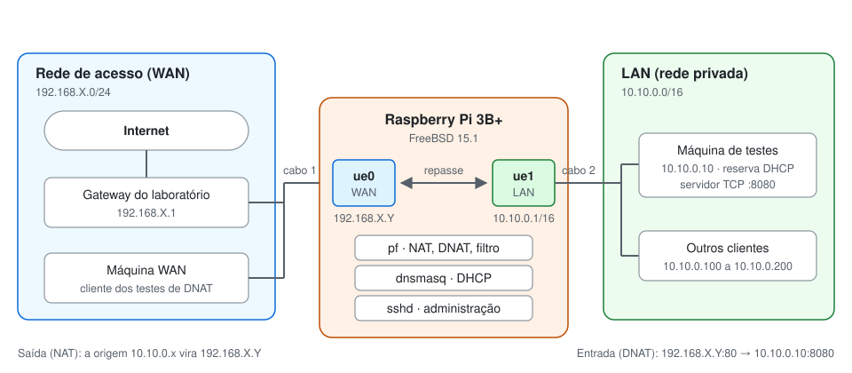

# Roteador FreeBSD na Raspberry Pi

**Trabalho 02 · Camada de Rede: NAT, DHCP e DNAT**
Fundamentos de Redes de Computadores · UnB Gama · Prof. Tiago Alves

Uma Raspberry Pi com duas interfaces de rede passa a ser o roteador entre a rede de acesso do laboratório (WAN) e uma rede privada criada por nós (LAN). Todo o tráfego entre as duas atravessa a Pi, que distribui endereços na LAN, traduz endereços na saída e controla o que pode entrar.



## Como este projeto está organizado

| Arquivo | Para quê | Quando usar |
| --- | --- | --- |
| [README.md](README.md) | Documentação mínima pedida no enunciado | Ler primeiro |
| [docs/1-conceitos.md](docs/1-conceitos.md) | A teoria do Kurose aplicada ao roteador | Estudar |
| [docs/2-um-dia-na-vida.md](docs/2-um-dia-na-vida.md) | Uma requisição web atravessando a Pi, camada por camada | Entender o todo |
| [docs/3-instalacao.md](docs/3-instalacao.md) | Do cartão vazio ao roteador pronto | Montar ou reconstruir |
| [docs/4-testes.md](docs/4-testes.md) | Um teste por requisito, com comandos para Mac, Windows e Linux | Validar |
| [docs/5-apresentacao.md](docs/5-apresentacao.md) | Montagem, sequência e falas do dia da avaliação | Apresentar |
| [rc.conf](rc.conf), [dnsmasq.conf](dnsmasq.conf), [pf.conf](pf.conf) | Os arquivos exatos que vão para a Pi | Instalar |
| [referencias/](referencias/) | Enunciado do trabalho | Consultar |

Os três arquivos `.conf` são a fonte da verdade: toda mudança é feita aqui e copiada para a Pi.

## Sistema operacional

**FreeBSD 15.1-RELEASE**, arquitetura arm64, a partir da imagem oficial para Raspberry Pi, sem derivação nem pacote de gateway pronto. Pela tabela do enunciado, \*BSD tem teto de 100% da nota. As versões exatas em uso ficam em `versoes.txt`, gerado na [montagem do ZIP](#montar-o-zip).

Hardware: Raspberry Pi 3B+ e adaptador USB-Ethernet TP-Link.

## Aplicações

| Aplicação | Origem | Papel |
| --- | --- | --- |
| pf | Sistema base | NAT, DNAT e filtro de pacotes |
| pflog | Sistema base | Registro dos pacotes bloqueados com `log` |
| dnsmasq | Pacote (`pkg install dnsmasq`) | Servidor DHCP da LAN |
| sshd | Sistema base | Administração remota |
| ntpd | Sistema base | Hora certa nos logs, já que a Pi não tem bateria |

Nos testes: `tcpdump` e `pfctl` na Pi; `nc` ou `ncat`, `telnet`, `curl` e `nslookup` nos hosts.

## Arquivos de configuração

| Arquivo | Destino na Pi | Validação | O que define |
| --- | --- | --- | --- |
| [rc.conf](rc.conf) | `/etc/rc.conf` | `sh -n /etc/rc.conf` | Interfaces, repasse e serviços ativos no boot |
| [dnsmasq.conf](dnsmasq.conf) | `/usr/local/etc/dnsmasq.conf` | `dnsmasq --test` | O que os clientes da LAN recebem por DHCP |
| [pf.conf](pf.conf) | `/etc/pf.conf` | `pfctl -nf /etc/pf.conf` | Tradução e o que pode atravessar o roteador |

Os arquivos não se leem entre si; a ligação depende de valores repetidos. A WAN é a `ue0` e a LAN é a `ue1` nos três. O IP 10.10.0.10 aparece na reserva do `dnsmasq.conf` e na macro `servidor_lan` do `pf.conf`, e trocar um exige trocar o outro.

## Como implementar

O passo a passo completo está em [docs/3-instalacao.md](docs/3-instalacao.md). Em resumo:

1. Gravar a imagem do FreeBSD 15.1 no cartão e fazer o primeiro boot.
2. Trocar as senhas padrão e acessar por SSH.
3. Conferir que `ue0` é a porta da Pi e `ue1` é o TP-Link.
4. Instalar o `dnsmasq`.
5. Copiar os três arquivos, validar e reiniciar.
6. Reservar o 10.10.0.10 para o MAC do host de testes.

## Como validar

Os testes estão em [docs/4-testes.md](docs/4-testes.md), cada um ligado a um requisito:

| Requisito do enunciado | Onde está implementado | Teste |
| --- | --- | --- |
| WAN com IP da rede de acesso | `ifconfig_ue0` no `rc.conf` | [1](docs/4-testes.md#1-conectividade) |
| LAN /16 em faixa reservada | `ifconfig_ue1="inet 10.10.0.1/16"` no `rc.conf` | [1](docs/4-testes.md#1-conectividade) |
| NAT entre a rede de acesso e a LAN | Regra `nat` no `pf.conf` | [2](docs/4-testes.md#2-tradução-de-endereço-nat) |
| Teste de conectividade | — | [1](docs/4-testes.md#1-conectividade) |
| Teste de tradução de endereço | — | [2](docs/4-testes.md#2-tradução-de-endereço-nat) |
| Teste de isolamento de segmento | Regra `block in on $ext_if all` no `pf.conf` | [3](docs/4-testes.md#3-isolamento-de-segmento) |
| DHCP para os clientes da LAN | `dhcp-range` e `option:router` no `dnsmasq.conf` | [4](docs/4-testes.md#4-dhcp) |
| DNS 192.168.X.1 ou 164.41.101.4/.11 | `option:dns-server` no `dnsmasq.conf` | [1](docs/4-testes.md#1-conectividade) e [4](docs/4-testes.md#4-dhcp) |
| Mesmo IP sempre para a máquina de testes | `dhcp-host` no `dnsmasq.conf` | [4](docs/4-testes.md#4-dhcp) |
| Leases conferidas em arquivo de log | `dhcp-leasefile` e `log-facility` no `dnsmasq.conf` | [4](docs/4-testes.md#4-dhcp) |
| DNAT da porta 80 da WAN para a 8080 da LAN | Regras `rdr ... tag DNAT` e `pass ... tagged DNAT` no `pf.conf` | [5](docs/4-testes.md#5-dnat-da-porta-80-para-a-8080) |
| Servidor e cliente TCP com netcat e telnet | — | [5](docs/4-testes.md#5-dnat-da-porta-80-para-a-8080) |

## Limitações conhecidas

- **Vazão.** As duas interfaces dividem o mesmo barramento USB 2.0 e a CPU faz a cópia entre elas, então o roteador fica muito abaixo de 1 Gbit/s.
- **Cartão SD.** Desligar sem `shutdown -p now` pode corromper o sistema.
- **Relógio.** Sem bateria, a hora depende do NTP; sem Internet, os logs podem sair com hora errada.
- **Apenas IPv4.** NAT, DHCP e filtro não tratam IPv6.
- **DNAT para um único destino.** A porta 80 da WAN sempre vai para 10.10.0.10:8080, e a regra não vale para quem acessa o IP da WAN de dentro da LAN.
- **Gateway obrigatório no servidor.** O `rdr` preserva a origem real, então 10.10.0.10 precisa usar a Pi como gateway para que a resposta volte traduzida.
- **Um host de testes por vez.** A reserva aceita vários MACs para 10.10.0.10, mas só um deles pode estar ligado à LAN de cada vez.
- **Roteador exposto à WAN.** SSH e ping continuam liberados para a própria Pi.
- **DNS externo.** O `dnsmasq` não responde consultas; os clientes dependem do servidor informado.
- **Nomes das interfaces.** `ue0` e `ue1` dependem da ordem de detecção USB e devem ser conferidos a cada montagem.

## Montar o ZIP

Primeiro, garanta que a Pi roda exatamente os arquivos do projeto (passos 6 e 7 de [docs/3](docs/3-instalacao.md)). Depois, na Pi, como root, valide e registre as versões:

```sh
sh -n /etc/rc.conf && pfctl -nf /etc/pf.conf && dnsmasq --test
{ freebsd-version -ku; uname -m; dnsmasq --version | head -1; } > /tmp/versoes.txt
```

No computador, na pasta do projeto, traga o arquivo de versões e compacte:

```sh
scp freebsd@IP_DA_PI:/tmp/versoes.txt .
```

```powershell
# Windows (PowerShell)
New-Item -ItemType Directory -Force entrega
Compress-Archive -Force -Path README.md, rc.conf, dnsmasq.conf, pf.conf, versoes.txt, docs -DestinationPath entrega\trabalho02.zip
```

```sh
# macOS e Linux
mkdir -p entrega
zip -r entrega/trabalho02.zip README.md rc.conf dnsmasq.conf pf.conf versoes.txt docs
```

## Fontes

- Kurose, J. F.; Ross, K. W. *Computer Networking: A Top-Down Approach*, 8ª ed., Pearson. Cap. 4 (camada de rede) e §6.7 (retrospectiva).
- [pf.conf(5), FreeBSD 15.1](https://man.freebsd.org/cgi/man.cgi?manpath=freebsd-release&query=pf.conf&sektion=5): ordem das seções, tradução, estados e `tag`.
- [dnsmasq(8)](https://www.thekelleys.org.uk/dnsmasq/docs/dnsmasq-man.html): opções de DHCP e registro.
- [FreeBSD Handbook: Advanced Networking](https://docs.freebsd.org/en/books/handbook/advanced-networking/): gateways e rotas.
- [muge(4)](https://man.freebsd.org/cgi/man.cgi?format=html&query=muge&sektion=4): driver da porta de rede da Pi.
- [RFC 1918](https://www.rfc-editor.org/rfc/rfc1918): endereços privados.
- [RFC 2131](https://www.rfc-editor.org/rfc/rfc2131): DHCP.
- [RFC 3022](https://www.rfc-editor.org/rfc/rfc3022): NAT tradicional e sessões de entrada por mapeamento estático.
- [Anúncio do FreeBSD 15.1-RELEASE](https://www.freebsd.org/releases/15.1R/announce/): imagem, checksum e usuários padrão.

As obras citadas no enunciado, de Wright e Stevens e de Lucas, não foram consultadas.
