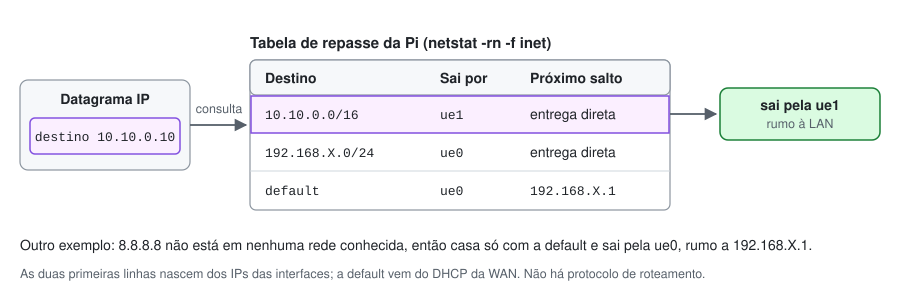
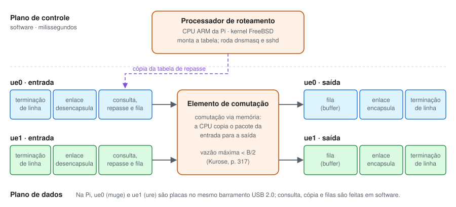
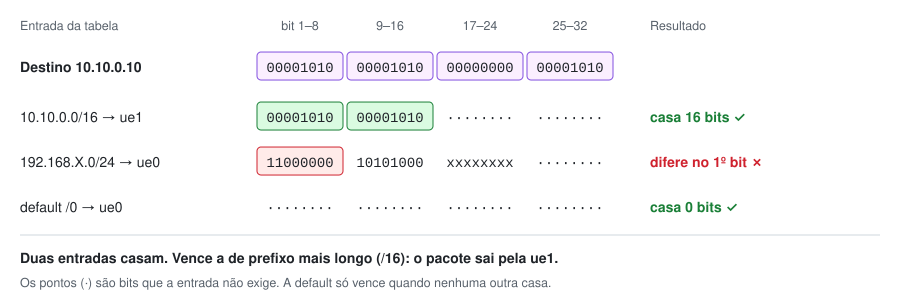
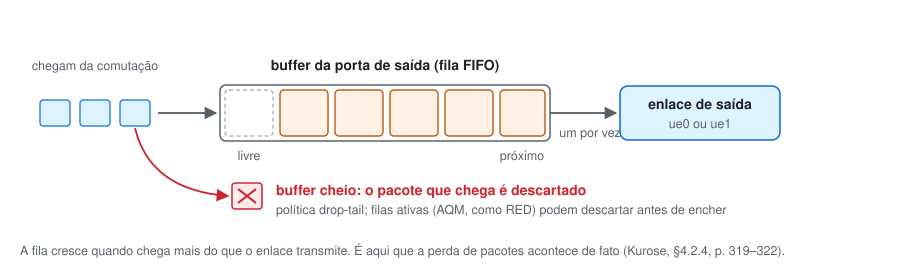
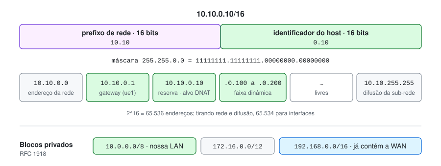
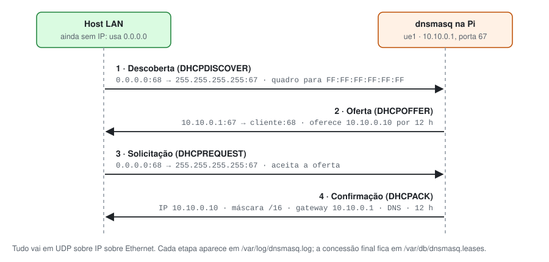
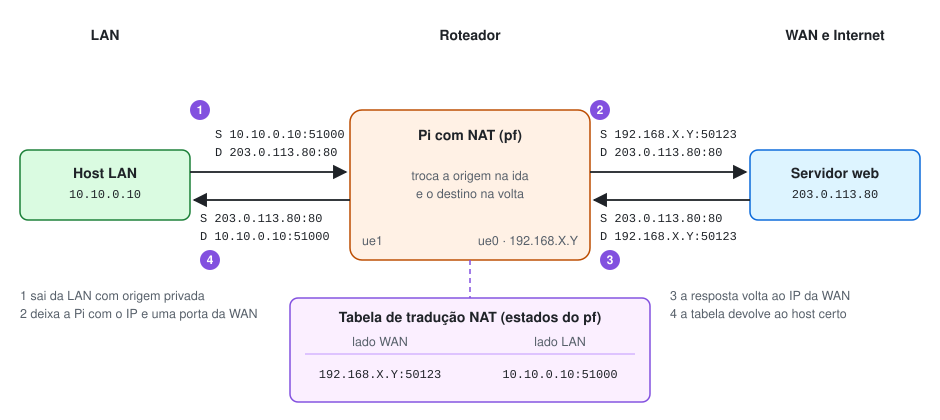
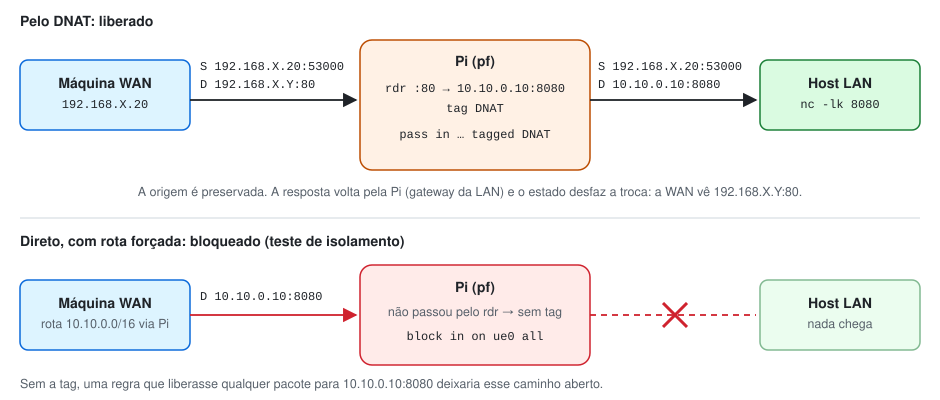
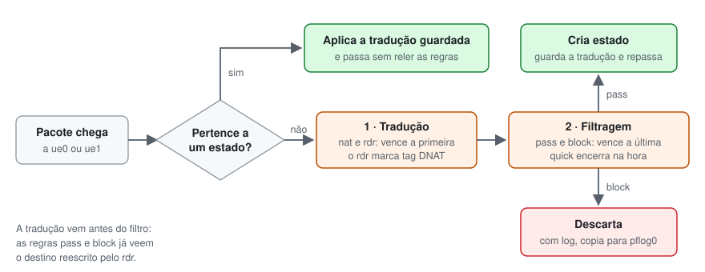

# Conceitos: a camada de rede no nosso roteador

Este documento reúne a teoria que sustenta o trabalho. Cada seção segue o Kurose e Ross (*Computer Networking: A Top-Down Approach*, 8ª ed.) e termina em **No nosso trabalho**, que mostra onde o conceito aparece na Pi. As páginas citadas são as da edição impressa.

A ordem acompanha o caminho de um pacote: primeiro o papel da camada de rede, depois o interior do roteador e, por fim, os serviços que configuramos: endereçamento, DHCP e NAT.

1. [Papel da camada de rede: repasse e roteamento](#1-papel-da-camada-de-rede-repasse-e-roteamento)
2. [Tabela de repasse](#2-tabela-de-repasse)
3. [O que há dentro de um roteador](#3-o-que-há-dentro-de-um-roteador)
4. [Porta de entrada: prefixo mais longo e hardware](#4-porta-de-entrada-prefixo-mais-longo-e-hardware)
5. [Porta de saída: buffer e transmissão](#5-porta-de-saída-buffer-e-transmissão)
6. [Sub-rede, máscara e CIDR](#6-sub-rede-máscara-e-cidr)
7. [DHCP](#7-dhcp)
8. [NAT, WAN e LAN](#8-nat-wan-e-lan)

---

## 1. Papel da camada de rede: repasse e roteamento

A camada de rede leva um pacote do hospedeiro de origem ao de destino. Na origem, ela recebe o segmento da camada de transporte e o encapsula em um **datagrama**. No destino, faz o inverso. Os roteadores do caminho apenas repassam o datagrama, por isso o livro os desenha com a pilha cortada acima da camada de rede: eles não rodam transporte nem aplicação (Kurose, §4.1, p. 304).

Para cumprir esse papel, a camada de rede tem duas funções que o livro faz questão de separar (§4.1.1, p. 304–306):

| | Repasse (*forwarding*) | Roteamento (*routing*) |
| --- | --- | --- |
| Alcance | Local, dentro de um roteador | A rede inteira, de ponta a ponta |
| O que faz | Move o pacote do enlace de entrada para o de saída | Calcula os caminhos entre origem e destino |
| Tempo | Nanossegundos, em hardware | Segundos, em software |
| Plano | Dados | Controle |
| Analogia | Atravessar um trevo da estrada | Planejar a viagem no mapa |

As duas se ligam pela tabela de repasse: o plano de controle a preenche, e o plano de dados a consulta a cada pacote.

> **No nosso trabalho.** A Pi faz apenas repasse. A linha `gateway_enable="YES"` do [rc.conf](../rc.conf) liga `net.inet.ip.forwarding`; sem ela, o FreeBSD descarta o que não for endereçado a ele mesmo, e a Pi seria só um computador com duas placas. Não há OSPF nem BGP: o plano de controle se resume ao kernel criar rotas a partir dos IPs das interfaces e do DHCP da WAN.

## 2. Tabela de repasse

Todo roteador tem uma tabela de repasse. Ele lê um campo do cabeçalho do pacote, usa esse valor como índice na tabela e obtém a interface de saída (Kurose, p. 306). No repasse baseado em destino, o campo é o IP de destino.

Uma linha por endereço seria inviável, porque o IPv4 tem mais de 4 bilhões deles. Por isso a tabela guarda **faixas** de endereços, escritas como prefixos (p. 314–315).



> **No nosso trabalho.** `netstat -rn -f inet` mostra a tabela da Pi. Em um trecho simplificado:
>
> ```text
> Destination        Gateway            Flags     Netif
> default            192.168.X.1        UGS         ue0
> 10.10.0.0/16       link#2             U           ue1
> 192.168.X.0/24     link#1             U           ue0
> ```
>
> As linhas `link#N` são entrega direta: o destino está na própria sub-rede da interface. A `default` aponta para o gateway da rede de acesso e é aprendida pelo DHCP da `ue0`.

## 3. O que há dentro de um roteador

O livro identifica quatro componentes em um roteador genérico (Fig. 4.4, §4.2, p. 311–312):

- **Portas de entrada.** Terminam o enlace físico, fazem o processamento de enlace e, principalmente, consultam a tabela de repasse para escolher a porta de saída. Pacotes de controle, como os de protocolos de roteamento, seguem para o processador. Aqui "porta" é a interface física, não a porta TCP ou UDP.
- **Elemento de comutação.** Liga as portas de entrada às de saída. O livro o chama de "uma rede dentro do roteador".
- **Portas de saída.** Guardam os pacotes vindos da comutação e os transmitem, refazendo enlace e camada física.
- **Processador de roteamento.** Executa o plano de controle: roda os protocolos de roteamento, calcula a tabela e cuida da gerência.

Portas e comutação ficam em hardware por uma questão de tempo. Com um enlace de 100 Gbit/s e datagramas de 64 bytes, a porta tem 5,12 ns para tratar cada um antes que chegue o próximo (p. 312). O plano de controle trabalha em milissegundos e roda em software, numa CPU comum (p. 313).

O livro compara o roteador a uma rotatória. A entrada, com um atendente que consulta o destino, é a porta de entrada; a rotatória é a comutação; a rua de saída é a porta de saída (p. 313).

A comutação pode ser feita de três formas: via memória, via barramento ou via rede de interconexão (p. 317–319). Na **comutação via memória**, a mais antiga, o roteador é um computador comum: a porta de entrada interrompe a CPU, o pacote é copiado para a memória, a CPU consulta a tabela e copia o pacote para o buffer da porta de saída. Como cada pacote é escrito e lido uma vez, a vazão fica abaixo de B/2, sendo B a taxa de acesso à memória (p. 317).



> **No nosso trabalho.** A Pi é exatamente um roteador de comutação via memória.
>
> | Componente (Fig. 4.4) | Na Raspberry Pi |
> | --- | --- |
> | Portas de entrada e saída | `ue0` (chip LAN7515, driver `muge`) e `ue1` (adaptador TP-Link, driver `ure`). A placa termina a linha e monta o quadro Ethernet. |
> | Elemento de comutação | A memória: o kernel copia o pacote do buffer de uma placa para o da outra. |
> | Processador de roteamento | A CPU ARM. O kernel mantém a tabela; `dnsmasq` e `sshd` rodam na mesma CPU. |
>
> Como tudo passa pela CPU e pelas duas placas USB, a vazão fica muito abaixo de um roteador dedicado. Essa é uma das limitações declaradas no [README](../README.md#limitações-conhecidas).

## 4. Porta de entrada: prefixo mais longo e hardware

A porta de entrada encadeia três etapas: terminação de linha, processamento de enlace (desencapsular o quadro) e consulta, repasse e fila (Fig. 4.5, p. 314). A tabela é calculada pelo processador e copiada para cada placa de linha. Com essa cópia local, cada porta decide sozinha, sem consultar a CPU central a cada pacote (p. 314).

**Regra do prefixo mais longo.** Um destino pode casar com mais de uma linha da tabela. No exemplo do livro, os 24 primeiros bits de um endereço casam com uma entrada e os 21 primeiros casam com outra. O roteador escolhe a entrada de **prefixo mais longo**, a mais específica (p. 315).



**Execução em hardware.** Em enlaces de gigabits, a consulta precisa terminar em nanossegundos. Uma busca linear não serve; usam-se algoritmos rápidos, memórias SRAM na frente da DRAM e, com frequência, **TCAM** (*Ternary Content Addressable Memory*), que recebe o endereço de 32 bits e devolve a entrada em tempo praticamente constante. Roteadores Cisco guardam mais de um milhão de entradas em TCAM (p. 316).

A consulta não é a única tarefa. A porta também confere a versão, o *checksum* e o TTL do datagrama, reescreve o TTL e o *checksum* e atualiza contadores de gerência (p. 316).

**Casamento e ação.** O livro fecha a seção com uma generalização: consultar o destino e enviar à porta de saída é um caso de **casamento mais ação** (*match plus action*). Um firewall casa campos do cabeçalho e descarta o pacote; um NAT casa a porta e a reescreve (p. 316).

> **No nosso trabalho.** Na Pi, a consulta é feita em software, pelas estruturas de busca do kernel; não há TCAM. Para três rotas e dezenas de Mbit/s, isso basta. O TTL também é decrementado aqui: um `traceroute` (ou `tracert` no Windows) a partir da LAN mostra 10.10.0.1 como primeiro salto.
>
> O pf é o "casamento mais ação" na prática. A mesma Pi faz três ações sobre o que casa: repassar (tabela de repasse), descartar (regras `block`) e reescrever (regras `nat` e `rdr`).

## 5. Porta de saída: buffer e transmissão

A porta de saída pega os pacotes guardados em sua memória, escolhe o próximo a sair (escalonamento), retira-o da fila e faz o trabalho de enlace e de camada física para transmiti-lo (Fig. 4.7, §4.2.3, p. 319).

Filas podem se formar nos dois lados do roteador, conforme a carga, a velocidade da comutação e a velocidade das linhas (§4.2.4, p. 319):

- **Na entrada**, quando a comutação é mais lenta que as linhas. Surge o bloqueio de cabeça de fila (HOL): um pacote espera atrás de outro que disputa a mesma saída, mesmo que a sua esteja livre. Sob certas hipóteses, o HOL faz a fila de entrada crescer sem limite quando a chegada atinge só 58% da capacidade dos enlaces (p. 320–321).
- **Na saída**, mesmo com comutação rápida. Se N entradas mandam para a mesma saída, chegam N pacotes no tempo de transmitir um (p. 321).

Quando o buffer enche, o roteador descarta o pacote que chega (*drop-tail*) ou usa um algoritmo de gerência ativa de fila (AQM), como RED, PIE ou CoDel, que descarta ou marca pacotes antes de encher (p. 322). Segundo o livro, é nessas filas que os pacotes "perdidos na rede" são de fato descartados (p. 319).



> **No nosso trabalho.** As duas placas da Pi dividem o mesmo barramento USB 2.0, com 480 Mbit/s nominais, e a cópia entre elas é feita pela CPU. Se a WAN entregar mais do que a Pi consegue repassar, as filas crescem no kernel e os pacotes excedentes são descartados. Não configuramos escalonamento: a fila é FIFO, por ordem de chegada.

## 6. Sub-rede, máscara e CIDR

**Interface.** É a fronteira entre um equipamento e um enlace. O IP pertence à interface, não ao equipamento, então um roteador tem um IP para cada enlace (p. 334).

**Sub-rede.** É o conjunto de interfaces que se alcançam sem atravessar um roteador. A receita do livro: desligue cada interface de seu equipamento, e cada "ilha" de rede isolada que sobrar é uma sub-rede (p. 334–336).

**Máscara.** Na notação 223.1.1.0/24, o /24 é a máscara: os 24 bits mais à esquerda formam o endereço da sub-rede (p. 335).

**CIDR.** O *Classless Interdomain Routing* generaliza a sub-rede na forma a.b.c.d/x. Os x bits mais significativos são o **prefixo** de rede; os 32 − x restantes identificam a interface. Fora da organização, os roteadores olham só o prefixo, e uma única linha cobre a rede inteira (p. 336–337). Antes do CIDR, o prefixo só podia ter 8, 16 ou 24 bits (classes A, B e C), o que desperdiçava endereços: um /16 atende 65.534 interfaces (p. 338).

O endereço **255.255.255.255** é a difusão: um datagrama enviado a ele chega a todos os hospedeiros da mesma sub-rede (p. 340). O DHCP depende dele.



**Como um hospedeiro decide para onde mandar.** Ele aplica a máscara ao destino. Para 10.10.0.10 AND 255.255.0.0 = 10.10.0.0, o resultado é a própria sub-rede, então a entrega é direta. Para 8.8.8.8 AND 255.255.0.0 = 8.8.0.0, o resultado é outra rede, e o pacote vai ao gateway padrão.

> **No nosso trabalho.** Pela receita do livro, a Pi separa duas ilhas: a WAN na `ue0` e a LAN na `ue1`. A LAN é `10.10.0.0/16`: tem a máscara /16 pedida no enunciado e fica dentro de 10.0.0.0/8, bloco reservado pelo RFC 1918 para redes privadas.
>
> O bloco 192.168.0.0/16 não serviria. Ele contém a WAN do laboratório, 192.168.X.0/24, e pela regra do prefixo mais longo qualquer destino 192.168.X.\* sairia pela `ue0`, mesmo sendo da LAN.
>
> A máscara aparece em dois arquivos: `ifconfig_ue1="inet 10.10.0.1/16"` no [rc.conf](../rc.conf) e `255.255.0.0` no `dhcp-range` do [dnsmasq.conf](../dnsmasq.conf).

## 7. DHCP

Um hospedeiro precisa de quatro informações para usar a rede: o próprio IP, a máscara, o gateway padrão (o roteador do primeiro salto) e o servidor DNS. O DHCP (*Dynamic Host Configuration Protocol*, RFC 2131) entrega tudo isso automaticamente, por isso é chamado de *plug-and-play*. O administrador escolhe se um equipamento recebe sempre o mesmo IP ou um endereço temporário (p. 341–342).

O DHCP é cliente-servidor. Em geral, há um servidor por sub-rede; sem ele, um roteador precisa atuar como agente de retransmissão (p. 342). Para um cliente recém-chegado, a troca tem quatro etapas (Fig. 4.24, p. 342–344):

1. **Descoberta.** O cliente não tem IP nem conhece o servidor. Envia um DHCPDISCOVER em UDP para a porta 67, com origem 0.0.0.0 ("este hospedeiro") e destino 255.255.255.255. A camada de enlace difunde o quadro para toda a sub-rede.
2. **Oferta.** O servidor responde com um DHCPOFFER, que leva o ID da transação, o IP proposto, a máscara e o tempo de concessão (*lease*). Se houver mais de um servidor, o cliente escolhe uma das ofertas.
3. **Solicitação.** O cliente responde à oferta escolhida com um DHCPREQUEST, repetindo os parâmetros.
4. **Confirmação.** O servidor confirma com um DHCPACK. A partir daí, o cliente usa o endereço até o fim da concessão, que pode ser renovada.



O livro mostra a oferta e o ACK por difusão. No exemplo do Cap. 6, porém, o ACK segue em quadro *unicast* (p. 514). Se a captura mostrar *unicast*, o comportamento é normal.

> **No nosso trabalho.** O `dnsmasq` é o servidor da LAN. Cada linha do [dnsmasq.conf](../dnsmasq.conf) corresponde a um conceito:
>
> | Linha | Conceito |
> | --- | --- |
> | `port=0` | Desliga o DNS do dnsmasq; ele faz só DHCP |
> | `interface=ue1` | Um servidor por sub-rede: atende apenas a LAN |
> | `dhcp-authoritative` | Único servidor da rede, então responde sem hesitar |
> | `dhcp-range=10.10.0.100,10.10.0.200,255.255.0.0,12h` | Endereços temporários, máscara /16 e concessão de 12 horas |
> | `dhcp-option=option:router,10.10.0.1` | Gateway padrão |
> | `dhcp-option=option:dns-server,...` | Servidor DNS |
> | `dhcp-host=MAC,...,10.10.0.10` | "O mesmo IP a cada conexão", reconhecido pelo MAC |
> | `dhcp-leasefile`, `log-dhcp`, `log-facility` | Onde conferir as concessões e as quatro etapas |
>
> A Pi também é cliente DHCP: `ifconfig_ue0="DHCP"` pede um endereço à rede de acesso. É o cenário que o livro descreve em uma observação: o roteador recebe seu IP do DHCP do provedor e roda um servidor DHCP para a rede interna (p. 345).

## 8. NAT, WAN e LAN

**O problema.** Cada equipamento IP precisa de um endereço. Se uma rede doméstica ou de escritório tivesse de pedir ao provedor um bloco para todos os seus aparelhos, cada nova máquina seria um problema de administração. O NAT (*Network Address Translation*, RFC 3022) resolve isso (p. 344).

**WAN e LAN.** O roteador com NAT tem um lado **LAN**, voltado para a rede interna, com endereços privados, e um lado **WAN**, voltado para o provedor, com um endereço válido lá fora (Fig. 4.25, p. 345). Endereços privados, como os de 10.0.0.0/8 (RFC 1918), só têm significado dentro da própria rede, porque milhares de redes usam os mesmos.

**Como funciona.** Para o mundo externo, o roteador com NAT não parece um roteador: ele se apresenta como um único equipamento com um único IP. Todo pacote que sai tem como origem o IP da WAN, e todo pacote que entra tem esse IP como destino (p. 345).

**A tabela de tradução.** Se tudo chega ao mesmo IP, o roteador precisa saber a qual máquina interna entregar. Para isso, guarda em uma **tabela de tradução NAT** pares de IP e porta (p. 346):

1. O host 10.0.0.1 pede uma página ao servidor 128.119.40.186:80, a partir da porta 3345.
2. O roteador troca a origem por 138.76.29.7:5001, seu IP de WAN e uma porta que não esteja em uso, e grava o par na tabela.
3. O servidor responde para 138.76.29.7:5001, sem saber que houve tradução.
4. O roteador consulta a tabela, troca o destino de volta para 10.0.0.1:3345 e entrega.

Como o campo de porta tem 16 bits, um único IP de WAN sustenta mais de 60 mil conexões simultâneas (p. 346). O RFC 3022 chama essa variante, que traduz IP e porta, de NAPT.



**Críticas e o caso do servidor interno.** O livro registra duas objeções (p. 346). Portas existem para endereçar processos, não máquinas. E um roteador deveria processar pacotes só até a camada de rede, sem reescrever portas. A consequência prática é que um servidor dentro da LAN não recebe conexões de fora: uma conexão que nasce na WAN não encontra par na tabela. A saída é criar o par antes, como um **mapeamento estático**, que o RFC 3022 descreve para sessões de entrada. É o que chamamos de **DNAT**.



**Como o pf aplica tudo isso.** O pf usa uma tabela de estados. O primeiro pacote aceito de uma conexão cria um estado, que também guarda a tradução, e os pacotes seguintes passam direto por ele: é a tabela NAT do livro. Um pacote novo passa por duas etapas, nesta ordem: tradução (vence a primeira regra que casa) e filtragem (vence a última, salvo uma regra `quick`). Como a tradução vem primeiro, o filtro já enxerga o destino reescrito ([pf.conf(5)](https://man.freebsd.org/cgi/man.cgi?manpath=freebsd-release&query=pf.conf&sektion=5)).



> **No nosso trabalho.** Três linhas do [pf.conf](../pf.conf) fazem o serviço:
>
> | Regra | O que faz |
> | --- | --- |
> | `nat on $ext_if inet from $lan_net to any -> ($ext_if)` | NAT: troca a origem 10.10.x.x pelo IP atual da `ue0` |
> | `rdr on $ext_if ... port 80 tag DNAT -> $servidor_lan port 8080` | DNAT: o que chega a IP_WAN:80 segue para 10.10.0.10:8080 e recebe a marca `DNAT` |
> | `pass in on $ext_if inet proto tcp tagged DNAT` | Libera, vindo da WAN, apenas o que passou pelo `rdr` |
>
> **Por que a marca.** O filtro vê o destino já traduzido, então não distingue um pacote redirecionado de um enviado direto a 10.10.0.10:8080 por alguém que forçou uma rota. A marca separa os dois.
>
> **NAT não é firewall.** Sem mapeamento, a LAN fica inalcançável para conexões vindas de fora, mas isso só vale para quem mira o IP da WAN. Quem força uma rota para 10.10.0.0/16 via Pi chega sem precisar de tradução. Quem isola a LAN é o filtro, a regra `block in on $ext_if all`, no papel de firewall que o livro atribui aos roteadores de acesso (p. 347). O teste de isolamento ([docs/4](4-testes.md#3-isolamento-de-segmento)) prova exatamente isso.
>
> **Por que a resposta do DNAT volta pela Pi.** O `rdr` troca só o destino, então 10.10.0.10 vê o IP real do cliente da WAN. A resposta segue o gateway padrão entregue pelo DHCP, 10.10.0.1. Sem esse caminho, ela não passaria pela Pi e a tradução não seria desfeita.
>
> Para conferir: `pfctl -s nat` lista as regras de tradução e `pfctl -s state` mostra a tabela de tradução em uso.
