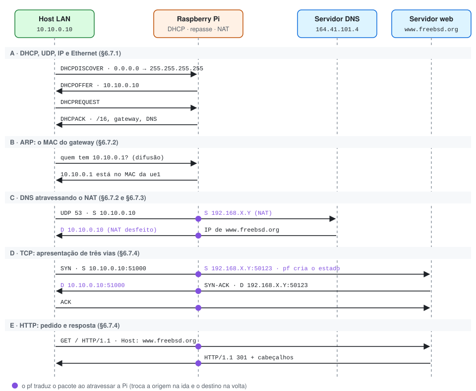

# Um dia na vida de uma requisição web, atravessando a Pi

No fim do Cap. 6, o Kurose junta tudo o que ensinou em uma única história: Bob liga o notebook na rede da escola e abre uma página web (§6.7, p. 512–517). Em 24 etapas, a história passa por DHCP, UDP, IP, Ethernet, ARP, DNS, TCP e HTTP.

O próprio livro avisa, na p. 517, que deixou de fora o NAT do roteador da escola. Nosso trabalho é justamente esse roteador. Este documento conta a mesma história na nossa rede, com o NAT de volta, e indica em cada fase um comando para vê-la acontecer.

## O cenário

| Na história do livro | Na nossa rede | Endereço |
| --- | --- | --- |
| Notebook do Bob | Host da LAN (Mac, Windows ou Linux) | MAC próprio; vai receber 10.10.0.10 |
| Roteador da escola, com servidor DHCP | Raspberry Pi | `ue1` 10.10.0.1 · `ue0` 192.168.X.Y |
| Rede do provedor (Comcast) | Rede de acesso do laboratório | gateway 192.168.X.1 |
| Servidor DNS do provedor | DNS indicado pelo professor | 164.41.101.4 |
| www.google.com | www.freebsd.org | resolvido pelo DNS |

Usamos `curl -I http://www.freebsd.org`, em HTTP simples na porta 80, para seguir o livro. Um navegador seria redirecionado em seguida para HTTPS (porta 443) e repetiria as fases D e E com criptografia.

Os pontos roxos marcam onde o pf traduz o pacote. Fora deles, a história é idêntica à do livro.

## A. Ligar o cabo: DHCP, UDP, IP e Ethernet

*Kurose, §6.7.1, etapas 1 a 7, p. 513–514.*

Sem IP, o host não consegue fazer nada na rede. Por isso, a primeira coisa que ele faz é pedir um endereço.

1. O sistema do host cria um DHCPDISCOVER e o coloca em um segmento UDP, da porta 68 para a 67. O segmento vai em um datagrama IP de 0.0.0.0 para 255.255.255.255, porque o host ainda não tem endereço.
2. O datagrama vai em um quadro Ethernet com destino FF:FF:FF:FF:FF:FF, a difusão, e origem no MAC do host.
3. A `ue1` da Pi recebe o quadro. Como o destino IP é de difusão, o datagrama não é repassado: sobe para o UDP e chega ao `dnsmasq` na porta 67.
4. O `dnsmasq` reconhece o MAC na linha `dhcp-host` e oferece 10.10.0.10. O host solicita e o servidor confirma com o DHCPACK, que leva IP, máscara 255.255.0.0, gateway 10.10.0.1, DNS e concessão de 12 horas.
5. O host grava o IP e instala o gateway na própria tabela de repasse como rota padrão. A partir daí, tudo o que estiver fora de 10.10.0.0/16 vai para 10.10.0.1.

**Ver ao vivo.** Na Pi, `tcpdump -eni ue1 port 67 or port 68` mostra os MACs e a difusão; `tail -f /var/log/dnsmasq.log` mostra as quatro etapas por nome. No host, os comandos de [docs/4](4-testes.md#comandos-por-sistema) mostram o IP, o gateway e o DNS recebidos.

## B. Descobrir o MAC do gateway: ARP

*Kurose, §6.7.2, etapas 9 a 12, p. 514–515.*

O host sabe o IP do gateway, mas um quadro Ethernet precisa do MAC.

6. O host difunde uma consulta ARP: "quem tem 10.10.0.1?".
7. A Pi reconhece o próprio endereço e responde, só para o host, com o MAC da `ue1`.

**Ver ao vivo.** Na Pi, `tcpdump -eni ue1 arp`. No host, `arp -a` passa a listar 10.10.0.1 com o MAC da `ue1`.

A Pi faz o mesmo do lado da WAN para descobrir o MAC de 192.168.X.1, o próximo salto da sua rota padrão.

## C. Resolver o nome: DNS atravessando o NAT

*Kurose, §6.7.2 e §6.7.3, etapas 8 e 13 a 17, p. 514–516.*

Para abrir a conexão, o host precisa do IP de www.freebsd.org.

8. O host monta uma consulta DNS em UDP para a porta 53 de 164.41.101.4, com origem em 10.10.0.10. O quadro vai para o **MAC da `ue1`**, mas o datagrama dentro dele tem como destino o **IP do servidor DNS**. O endereço de enlace aponta o próximo salto; o endereço IP aponta o destino final.
9. A Pi recebe o quadro, extrai o datagrama e consulta a tabela de repasse. Só a rota `default` casa com 164.41.101.4, então a saída é a `ue0`, rumo a 192.168.X.1.
10. Antes de sair, o pacote passa pelo pf. A regra `nat` troca a origem 10.10.0.10 por 192.168.X.Y e cria um estado com a tradução. O TTL é decrementado, e o datagrama segue em um novo quadro, com origem no MAC da `ue0` e destino no MAC do gateway do laboratório.
11. Os roteadores do laboratório, da universidade e da Internet repassam o datagrama pelas próprias tabelas, preenchidas por protocolos de roteamento intradomínio e pelo BGP. Essa parte já está fora da Pi.
12. O servidor responde para 192.168.X.Y. O pf encontra o estado, troca o destino de volta para 10.10.0.10 e repassa pela `ue1`. O host recebe o IP de www.freebsd.org.

**Ver ao vivo.** Em duas sessões SSH na Pi, `tcpdump -ni ue1 udp port 53` e `tcpdump -ni ue0 udp port 53`. No host, `nslookup www.freebsd.org`. A mesma consulta aparece com origem 10.10.0.10 na `ue1` e 192.168.X.Y na `ue0`.

## D. Abrir a conexão: TCP

*Kurose, §6.7.4, etapas 18 a 21, p. 516–517.*

13. O host cria um socket TCP e envia um SYN para a porta 80 do servidor, a partir de uma porta efêmera, por exemplo 51000. O quadro vai, outra vez, para o MAC da `ue1`.
14. A Pi não tem estado para essa conexão. A regra `pass in on ue1` aceita o SYN, e a regra `nat` troca a origem por 192.168.X.Y e uma porta livre, por exemplo 50123 (por padrão, o pf escolhe entre 50001 e 65535). O par fica na tabela de estados: é a tabela de tradução do livro.
15. O servidor responde com SYN-ACK para 192.168.X.Y:50123. O pf encontra o estado e entrega a 10.10.0.10:51000. O socket do host passa a "conectado".
16. O host envia o ACK, pelo mesmo caminho, e o *three-way handshake* termina.

**Ver ao vivo.** Na Pi, `pfctl -s state | grep :80`. A linha mostra o IP da WAN com o endereço original entre parênteses.

## E. Pedir a página: HTTP

*Kurose, §6.7.4, etapas 22 a 24, p. 517.*

17. O host escreve o `GET` no socket. A mensagem vira a carga de um segmento TCP e segue o mesmo caminho, com a mesma tradução.
18. O servidor responde. Com `curl -I`, a resposta é `HTTP/1.1 301 Moved Permanently`, que aponta para a versão HTTPS do site. O pf desfaz a tradução, e a resposta chega ao host.

**Ver ao vivo.** Na Pi, `tcpdump -ni ue0 -A tcp port 80` mostra o texto do `GET` e da resposta, com origem 192.168.X.Y. A mesma captura na `ue1` mostra 10.10.0.10.

## Epílogo: a mesma história ao contrário (DNAT)

Até aqui, toda conexão nasceu na LAN. No DNAT, ela nasce na WAN, e as fases A a C não existem: o cliente da WAN já tem IP e conhece o endereço da Pi.

1. Uma máquina da WAN, por exemplo 192.168.X.20, abre uma conexão TCP para 192.168.X.Y:80.
2. Não há estado. A regra `rdr` troca o destino por 10.10.0.10:8080 e marca o pacote com `tag DNAT`.
3. O filtro vê o destino já traduzido e libera o pacote pela regra `pass in on $ext_if inet proto tcp tagged DNAT`. O estado é criado.
4. A Pi repassa pela `ue1` e, se precisar, descobre por ARP o MAC de 10.10.0.10.
5. O `nc` do host responde para 192.168.X.20, a origem real, que foi preservada. Como esse destino está fora da LAN, a resposta vai para o gateway 10.10.0.1.
6. O pf encontra o estado e troca a origem de volta para 192.168.X.Y:80. A máquina da WAN nunca vê o endereço 10.10.0.10.

Esse caminho está na figura de [DNAT em docs/1](1-conceitos.md#8-nat-wan-e-lan) e é provado pelo [teste 5 em docs/4](4-testes.md#5-dnat-da-porta-80-para-a-8080).

## Quem faz o quê

| Fase | Protocolo | Camada | Quem faz, no trabalho | Onde está |
| --- | --- | --- | --- | --- |
| A | DHCP sobre UDP | Aplicação | `dnsmasq` na Pi | [dnsmasq.conf](../dnsmasq.conf) |
| B | ARP | Enlace | Kernel do host e da Pi | `arp -a` |
| C, D, E | Repasse IP | Rede | Kernel da Pi | `gateway_enable` no [rc.conf](../rc.conf) |
| C, D, E | NAT | Rede, com portas da camada de transporte | pf | regra `nat` no [pf.conf](../pf.conf) |
| C | DNS sobre UDP | Aplicação | Servidor externo | `option:dns-server` |
| D | TCP | Transporte | Host e servidor; a Pi só traduz | `pfctl -s state` |
| E | HTTP | Aplicação | Host e servidor | `curl -I` |
| Epílogo | DNAT | Rede | pf | regra `rdr` no [pf.conf](../pf.conf) |
