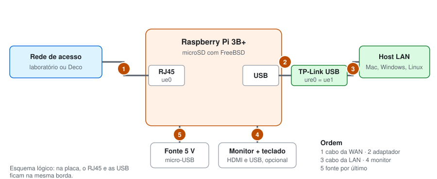

# Instalação: do cartão vazio ao roteador pronto

Este roteiro transforma uma Raspberry Pi 3B+ com um cartão vazio no roteador do trabalho. Ele serve para a primeira montagem e para reconstruir tudo se o cartão falhar. Cada passo termina com o resultado esperado; só avance quando ele aparecer.

**Regra do projeto:** os três arquivos da raiz ([rc.conf](../rc.conf), [dnsmasq.conf](../dnsmasq.conf) e [pf.conf](../pf.conf)) são a fonte da verdade. Qualquer mudança é feita aqui, no computador, e depois copiada para a Pi. Assim, o que vai no ZIP é sempre o que roda na Pi.

## 0. Material

| Item | Para quê |
| --- | --- |
| Raspberry Pi 3B+ e fonte de 5 V / 2,5 A | O roteador |
| Cartão microSD de 16 GB ou mais, de preferência de marca | Sistema |
| Adaptador USB-Ethernet TP-Link (driver `ure`) | Segunda interface, a LAN |
| Dois cabos de rede | WAN e LAN |
| Monitor HDMI e teclado USB | Primeiro boot e emergências |
| Computador com leitor de cartão | Gravar a imagem e acessar a Pi por SSH |
| Host de testes: Mac, Windows ou Linux | Máquina da LAN |



## 1. Gravar o cartão

1. Baixe `FreeBSD-15.1-RELEASE-arm64-aarch64-RPI.img.xz` na [área de downloads do FreeBSD 15.1](https://download.freebsd.org/releases/ISO-IMAGES/15.1/).
2. Confira a integridade do arquivo:

   | Sistema | Comando |
   | --- | --- |
   | Windows (PowerShell) | `Get-FileHash .\FreeBSD-15.1-RELEASE-arm64-aarch64-RPI.img.xz -Algorithm SHA256` |
   | macOS | `shasum -a 256 FreeBSD-15.1-RELEASE-arm64-aarch64-RPI.img.xz` |
   | Linux | `sha256sum FreeBSD-15.1-RELEASE-arm64-aarch64-RPI.img.xz` |

   O resultado deve ser `707bfa60224c548d0d37ffaaf80d85c750c7e943397737a0448a6f31942711a6`, sem diferenciar maiúsculas de minúsculas. Esse valor vem do [anúncio do FreeBSD 15.1](https://www.freebsd.org/releases/15.1R/announce/); se não bater, baixe de novo.
3. Abra o Raspberry Pi Imager e escolha o dispositivo **Raspberry Pi 3**.
4. Em sistema operacional, escolha **Use custom** e aponte para o arquivo baixado.
5. Selecione o cartão, confira duas vezes se é o disco certo e pule a personalização.
6. Clique em **Write** e espere terminar.

**Resultado esperado:** o Imager informa que a gravação e a verificação terminaram.

## 2. Primeiro boot

Coloque o cartão na Pi e ligue só o **cabo 1**: da porta de rede da própria Pi até a rede de acesso (o Deco em casa, a tomada no laboratório). Conecte monitor e teclado e, por último, a fonte. Deixe o adaptador TP-Link desconectado por enquanto.

Aguarde o `login:`, que demora mais no primeiro boot. Entre com `root` e senha `root`, os padrões da imagem. Rode um comando por vez, trocando `AAMMDDhhmm` pela data e hora atuais (por exemplo, `2611021530`):

```sh
passwd                 # nova senha do root
passwd freebsd         # nova senha do usuário do SSH
tzsetup                # fuso horário: America/Sao_Paulo
date AAMMDDhhmm
pkg update             # responda y para instalar o pkg
freebsd-version -ku
ifconfig ue0
```

As senhas padrão precisam ser trocadas porque o SSH fica aberto para a rede de acesso.

Agora deixe o monitor como console principal. Assim, uma falha no boot aparece na tela e o modo monousuário fica acessível:

```sh
sysrc -f /boot/loader.conf boot_serial="NO"
shutdown -r now
```

**Resultado esperado:** a Pi volta ao `login:`, `freebsd-version` mostra `15.1-RELEASE` e `ifconfig ue0` mostra um `inet` da rede de acesso. Anote esse IP: é o `IP_DA_PI`.

## 3. Acessar pela rede

Do computador, na mesma rede de acesso:

```sh
ssh freebsd@IP_DA_PI
su -
```

Se o SSH reclamar que a identidade da máquina mudou (acontece depois de regravar o cartão), remova a chave antiga com `ssh-keygen -R IP_DA_PI` e conecte de novo.

**Resultado esperado:** um prompt `root@generic:~ #` no computador. A partir daqui, monitor e teclado só são necessários em emergências.

## 4. Identificar as interfaces

Conecte o adaptador TP-Link em uma porta USB da Pi e rode:

```sh
dmesg | grep -E 'muge|ure|ue[0-9]'
ifconfig -l
```

**Resultado esperado:** `ue0` ligada a `muge0` (porta da Pi, WAN) e `ue1` ligada a `ure0` (TP-Link, LAN). Se aparecerem invertidas, troque `ue0` por `ue1` e vice-versa nos três arquivos de configuração antes de seguir.

Os nomes dependem da ordem de detecção USB, então repita essa conferência sempre que a Pi for montada em outro lugar.

## 5. Instalar o dnsmasq

```sh
pkg install -y dnsmasq
```

O pf já faz parte do sistema base. O `dnsmasq` é a única aplicação instalada.

**Resultado esperado:** `dnsmasq --version` mostra a versão instalada.

## 6. Ajustar e copiar os arquivos

**No computador, antes de copiar.** Abra o [dnsmasq.conf](../dnsmasq.conf) e confira duas linhas:

- **DNS.** O arquivo vem com o DNS do laboratório. Em casa, comente essa linha e ative a do Deco, trocando `IP_DO_DECO` pelo gateway da Pi (a linha `default` de `netstat -rn -f inet`).
- **Reserva.** A linha `dhcp-host` traz o MAC do Mac mini. Se o host de testes for outro, o [passo 9](#9-fixar-o-ip-do-host-de-testes) mostra como coletar o MAC.

Depois, na pasta deste projeto, copie os três arquivos para a Pi:

```sh
scp rc.conf dnsmasq.conf pf.conf freebsd@IP_DA_PI:/tmp/
```

**Na Pi, como root.** Guarde o `rc.conf` original, veja o que muda e instale os três arquivos:

```sh
cp /etc/rc.conf /etc/rc.conf.orig
diff /etc/rc.conf.orig /tmp/rc.conf
install -m 644 /tmp/rc.conf /etc/rc.conf
install -m 644 /tmp/pf.conf /etc/pf.conf
install -m 644 /tmp/dnsmasq.conf /usr/local/etc/dnsmasq.conf
```

O `diff` mostra as linhas da imagem que o nosso `rc.conf` não tem. Se aparecer alguma que pareça necessária, acrescente-a ao [rc.conf](../rc.conf) do projeto e copie de novo.

**Resultado esperado:** os três `install` terminam sem mensagem.

## 7. Validar e reiniciar

Um arquivo com erro de interpretação anula a entrega, então os três são validados antes de qualquer reinício:

```sh
sh -n /etc/rc.conf && kldload -n pf && pfctl -nf /etc/pf.conf && dnsmasq --test && shutdown -r now
```

O `kldload` carrega o módulo que o `pfctl` usa para conferir o arquivo. Se algum validador acusar erro, a cadeia para e mostra a linha do problema; corrija no projeto, copie de novo e repita.

O reinício substitui o `service pf start` porque ligar o pf com o SSH aberto congela a sessão: o pf só cria estado a partir do SYN que abre uma conexão TCP, e a sessão já aberta não envia outro. No boot, o pf e o pflog sobem na ordem certa.

**Resultado esperado:** `dnsmasq: syntax check OK.`, nenhuma saída dos outros validadores e a Pi reiniciando.

## 8. Conferir o roteador

Reconecte pelo SSH, rode `su -` e confira:

```sh
ifconfig ue1
sysctl net.inet.ip.forwarding
netstat -rn -f inet
service pf status
service pflog status
service dnsmasq status
pfctl -s nat
```

**Resultado esperado:**

| Comando | Deve mostrar |
| --- | --- |
| `ifconfig ue1` | `inet 10.10.0.1 netmask 0xffff0000` |
| `sysctl net.inet.ip.forwarding` | `net.inet.ip.forwarding: 1` |
| `netstat -rn -f inet` | `default` via o gateway da rede de acesso, `10.10.0.0/16` na `ue1` |
| `service pf status` | `Status: Enabled` |
| `service pflog status` | `pflogd` em execução |
| `service dnsmasq status` | `dnsmasq is running` |
| `pfctl -s nat` | uma regra `nat on ue0` e uma `rdr on ue0` |

## 9. Fixar o IP do host de testes

O DNAT aponta para 10.10.0.10, então o host de testes precisa receber sempre esse endereço. A reserva usa o MAC, que identifica o adaptador de rede.

1. Ligue o **cabo 2**: do TP-Link ao host de testes. Desligue o Wi-Fi do host, para que a Pi seja o único caminho.
2. Na Pi, veja a concessão recebida:

   ```sh
   cat /var/db/dnsmasq.leases
   ```

   Cada linha tem validade, MAC, IP e nome. Em `1793719969 18:4a:53:14:de:6d 10.10.0.183 Vitors-Mac-mini`, o MAC é `18:4a:53:14:de:6d`.
3. **No computador**, coloque o MAC na linha `dhcp-host` do [dnsmasq.conf](../dnsmasq.conf). Para três hosts (Mac, Windows e Linux), use a forma com vários MACs que está comentada no arquivo. Todos recebem 10.10.0.10, desde que só um esteja ligado à LAN por vez.
4. Copie, valide e aplique:

   ```sh
   # No computador
   scp dnsmasq.conf freebsd@IP_DA_PI:/tmp/

   # Na Pi, como root
   install -m 644 /tmp/dnsmasq.conf /usr/local/etc/dnsmasq.conf
   dnsmasq --test && service dnsmasq restart
   ```

5. Renove o IP no host de testes (comandos por sistema em [docs/4](4-testes.md#comandos-por-sistema)).

**Resultado esperado:** o host recebe 10.10.0.10, com gateway 10.10.0.1, e mantém o endereço a cada renovação.

## 10. No laboratório

Só a WAN e o DNS mudam. A LAN e o `pf.conf` continuam iguais, porque as regras usam `($ext_if)`, que acompanha o IP atual da `ue0`.

1. Pergunte ao professor o valor de **X**, se a WAN usa DHCP ou IP fixo e qual DNS usar.
2. **Se for IP fixo**, edite o [rc.conf](../rc.conf) do projeto: comente `ifconfig_ue0="DHCP"` e ative as duas linhas do laboratório, com X e Y preenchidos.
3. **DNS**, no [dnsmasq.conf](../dnsmasq.conf): deixe ativa só a linha indicada pelo professor.
4. Copie, instale e valide como nos passos 6 e 7.
5. Com IP fixo, a Pi não recebe DNS por DHCP. Antes de reiniciar, informe um servidor para ela própria:

   ```sh
   echo "nameserver 164.41.101.4" > /etc/resolv.conf
   ```

6. Reinicie e repita o passo 8.

## 11. Mudar um arquivo depois

Edite o arquivo no projeto, copie com `scp` para `/tmp/` da Pi e instale com `install -m 644`, como no passo 6. Depois aplique sem reiniciar, exceto no `rc.conf`:

| Arquivo | Validar e aplicar |
| --- | --- |
| `pf.conf` | `pfctl -nf /etc/pf.conf && pfctl -f /etc/pf.conf` (o recarregamento não derruba o SSH) |
| `dnsmasq.conf` | `dnsmasq --test && service dnsmasq restart` |
| `rc.conf` | `sh -n /etc/rc.conf && shutdown -r now` |

Se precisar corrigir algo direto na Pi, use `ee /etc/pf.conf` (ou o caminho do arquivo) e traga a versão corrigida de volta ao projeto com `scp freebsd@IP_DA_PI:/etc/pf.conf .`, para o ZIP não ficar desatualizado.

## 12. Problemas comuns

| Sintoma | Causa provável | O que fazer |
| --- | --- | --- |
| A Pi trava no boot | Algum serviço novo | Veja abaixo, "Recuperar uma Pi que não sobe" |
| O SSH não volta depois do reinício | IP da WAN mudou ou o pf bloqueou | No teclado da Pi, `ifconfig ue0`. Se o IP estiver certo, `pfctl -d` desliga o firewall sem apagar as regras |
| O host não recebe IP | Cabo fora da `ue1` ou dnsmasq parado | `service dnsmasq status` e `tail /var/log/dnsmasq.log` |
| O host recebe IP, mas não navega | DNS errado ou WAN sem saída | Na Pi, `ping -c 3 8.8.8.8`; confira a linha de DNS do `dnsmasq.conf` |
| Hora errada nos logs | Pi sem bateria e sem NTP | `service ntpd status`; ajuste com `date` se não houver internet |
| `ue0` e `ue1` invertidas | Ordem de detecção USB | Repita o passo 4 |

**Recuperar uma Pi que não sobe.** Na contagem do boot, pressione **Espaço** e digite `boot -s` no prompt `OK`. Quando o sistema pedir o shell, pressione Enter e rode:

```sh
fsck -y /
mount -u /
sysrc pf_enable="NO" pflog_enable="NO" dnsmasq_enable="NO"
reboot
```

Se a Pi subir assim, reative um serviço por vez com `sysrc ..._enable="YES"`, reiniciando a cada um, para encontrar o responsável.

**Desligar sempre com `shutdown -p now`** e esperar o sistema parar antes de tirar da tomada. Cortar a energia com o sistema ligado pode corromper o cartão.
