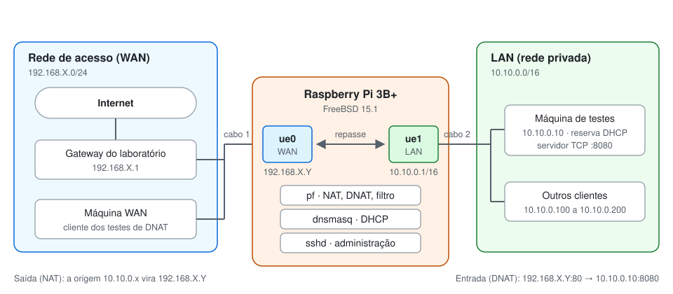

# Testes: provar cada requisito

Cada teste abaixo prova um requisito do enunciado. Rode todos em casa e repita no laboratório, porque lá a WAN muda.

Há três papéis:

- **Roteador:** a Pi, acessada por SSH como root (`ssh freebsd@IP_DA_PI` e `su -`).
- **LAN:** o host de testes ligado à `ue1`, com IP 10.10.0.10. Pode ser Mac, Windows ou Linux.
- **WAN:** outro aparelho na rede de acesso, do lado da `ue0`. Ele precisa conhecer o `IP_WAN_DA_PI`, que aparece em `ifconfig ue0` na Pi.



## Preparar os hosts

| | macOS | Windows | Linux |
| --- | --- | --- | --- |
| Instalar | Nada: `nc`, `curl` e `nslookup` já vêm no sistema. Não há `telnet`; use `nc`. | [Nmap](https://nmap.org/download.html), que traz o `ncat`. Telnet, em prompt de administrador: `dism /online /Enable-Feature /FeatureName:TelnetClient` | Debian/Ubuntu: `sudo apt install netcat-openbsd telnet dnsutils curl traceroute`. Fedora: `sudo dnf install nmap-ncat telnet bind-utils curl traceroute` |
| Firewall do host | Ajustes do Sistema > Rede > Firewall: permita conexões de entrada para o `nc` ou desligue durante o teste | Na primeira execução, permita o `ncat` também em redes públicas | `sudo ufw allow 8080/tcp` ou `sudo firewall-cmd --add-port=8080/tcp` |
| Wi-Fi | Desligado no host da LAN | Desligado no host da LAN | Desligado no host da LAN |

O firewall do host é um segundo filtro, independente do pf. Ele pode barrar o DNAT mesmo com o roteador correto.

## Comandos por sistema

Os testes citam ações; esta tabela traduz cada uma para o sistema em uso. `IF` é o nome da interface cabeada: no macOS, veja com `networksetup -listallhardwareports`; no Linux, com `ip link`.

| Ação | macOS | Windows | Linux |
| --- | --- | --- | --- |
| Ver IP | `ifconfig \| grep "inet 10.10"` | `ipconfig /all` | `ip -4 addr show` |
| Ver gateway | `route -n get default \| grep gateway` | `ipconfig /all` | `ip route show default` |
| Ver DNS | `scutil --dns \| grep nameserver` | `ipconfig /all` | `resolvectl dns` ou `cat /etc/resolv.conf` |
| Renovar DHCP | Desconectar e reconectar o cabo, ou `sudo ipconfig set IF DHCP` | `ipconfig /release` e depois `ipconfig /renew` | Desconectar e reconectar o cabo, ou `nmcli device disconnect IF && nmcli device connect IF` |
| Ping | `ping -c 3 DESTINO` | `ping DESTINO` | `ping -c 3 DESTINO` |
| Resolver nome | `nslookup www.freebsd.org` | `nslookup www.freebsd.org` | `nslookup www.freebsd.org` |
| Pedir página | `curl -I http://www.freebsd.org` | `curl.exe -I http://www.freebsd.org` | `curl -I http://www.freebsd.org` |
| Caminho até a Internet | `traceroute -n 8.8.8.8` | `tracert -d 8.8.8.8` | `traceroute -n 8.8.8.8` |
| Servidor TCP na 8080 | `nc -lk 8080` | `ncat -l -k 8080` | `nc -lk 8080` |
| Cliente TCP | `nc DESTINO PORTA` | `telnet DESTINO PORTA` | `telnet DESTINO PORTA` ou `nc DESTINO PORTA` |
| Forçar rota para a LAN | `sudo route -n add -net 10.10.0.0/16 IP_WAN_DA_PI` | `route add 10.10.0.0 mask 255.255.0.0 IP_WAN_DA_PI` (como administrador) | `sudo ip route add 10.10.0.0/16 via IP_WAN_DA_PI` |
| Remover a rota | `sudo route -n delete -net 10.10.0.0/16` | `route delete 10.10.0.0` | `sudo ip route del 10.10.0.0/16` |

## 1. Conectividade

**Requisito:** validar conectividade. **Prova:** o caminho LAN → Pi → Internet funciona em todas as camadas.

| Onde | Ação | Resultado esperado |
| --- | --- | --- |
| Roteador | `ping -c 3 8.8.8.8` | Respostas: a própria Pi tem saída |
| LAN | Ver IP, gateway e DNS | 10.10.0.10, gateway 10.10.0.1 e o DNS do `dnsmasq.conf` |
| LAN | Ping em 10.10.0.1 | Respostas: o gateway é alcançável |
| LAN | Resolver nome | `www.freebsd.org` resolvido para um IP |
| LAN | Pedir página | `HTTP/1.1 301 Moved Permanently`. Com `https://`, `HTTP/2 200` ou `HTTP/1.1 200` |
| LAN (opcional) | Caminho até a Internet | 10.10.0.1 como primeiro salto: a Pi decrementou o TTL |

## 2. Tradução de endereço (NAT)

**Requisito:** tradução de endereço. **Prova:** o endereço privado entra na Pi e sai trocado pelo IP da WAN.

Abra duas sessões SSH na Pi e deixe uma captura em cada uma:

```sh
# Sessão 1: lado da LAN
tcpdump -ni ue1 -c 4 tcp port 80

# Sessão 2: lado da WAN
tcpdump -ni ue0 -c 4 tcp port 80
```

Com as duas capturas em espera, peça a página no host da LAN (ação **Pedir página**). Depois, na Pi:

```sh
pfctl -s state | grep :80
```

**Resultado esperado.** Na `ue1`, a origem é `10.10.0.10`. Na `ue0`, a mesma conexão sai com origem no IP da WAN e outra porta. O `pfctl -s state` mostra a tradução: o IP da WAN com o endereço original entre parênteses.

Use `curl` em vez de navegador. Um navegador pode abrir várias conexões ao mesmo tempo ou usar QUIC, que roda sobre UDP e escapa do filtro `tcp port 80`.

## 3. Isolamento de segmento

**Requisito:** isolamento de segmento. **Prova:** a WAN só alcança a LAN pelo DNAT, mesmo quando tenta chegar diretamente.

1. **LAN:** deixe o servidor TCP na 8080 rodando.
2. **Roteador:** anote o contador da regra de bloqueio:

   ```sh
   pfctl -vs rules | grep -A1 "block drop in on ue0 all"
   ```

3. **WAN:** execute, nesta ordem:

   | Passo | Ação | Resultado esperado | Por quê |
   | --- | --- | --- | --- |
   | a | Ping em 10.10.0.10 | Falha | Sem rota, o pacote vai ao gateway do laboratório, que não conhece a LAN |
   | b | Forçar rota para a LAN | Rota criada | Agora os pacotes para 10.10.0.0/16 vão direto à Pi |
   | c | Ping em 10.10.0.10 | Falha | O pf descarta: só entra ping para o IP da própria Pi |
   | d | Cliente TCP para `10.10.0.10 8080` | Falha e nada aparece no servidor da LAN | O pacote não passou pelo `rdr`, então não tem a marca `DNAT` |
   | e | Remover a rota | Rota removida | Volta ao estado normal |

4. **Roteador:** repita o comando do passo 2.

**Resultado esperado.** Os dois pings e a conexão TCP falham, e o contador `Packets` da regra `block drop in on ue0 all` sobe.

O passo **d** é o que importa. Com uma regra que liberasse qualquer pacote para 10.10.0.10:8080, o ping falharia do mesmo jeito, mas a conexão TCP passaria. A explicação está em [docs/1, seção 8](1-conceitos.md#8-nat-wan-e-lan).

## 4. DHCP

**Requisitos:** prover a configuração da LAN, fixar o IP da máquina de testes e conferir as leases em arquivo de log.

| Onde | Ação | Resultado esperado |
| --- | --- | --- |
| LAN | Renovar DHCP e ver IP | Sempre 10.10.0.10 |
| LAN | Ver gateway e DNS | 10.10.0.1 e o DNS do `dnsmasq.conf` |
| Roteador | `cat /var/db/dnsmasq.leases` | Uma linha com validade, MAC, 10.10.0.10 e o nome do host |
| Roteador | `grep -E "DHCP(DISCOVER\|OFFER\|REQUEST\|ACK)" /var/log/dnsmasq.log \| tail` | As etapas da concessão, com o MAC do host |

Na primeira conexão aparecem as quatro etapas. Numa renovação, o cliente já conhece o servidor e costuma enviar só DHCPREQUEST, respondido com DHCPACK; o livro observa que apenas essas duas são de fato necessárias nesse caso (Kurose, p. 514).

Para acompanhar ao vivo, deixe `tail -f /var/log/dnsmasq.log` aberto na Pi enquanto renova o IP no host.

## 5. DNAT da porta 80 para a 8080

**Requisito:** redirecionar a porta TCP 80 da WAN para a 8080 de um cliente da LAN, com servidor e cliente TCP em netcat e telnet. **Prova:** uma conexão iniciada na WAN chega ao serviço interno.

1. **LAN:** inicie o servidor TCP na 8080.
2. **WAN:** conecte o cliente TCP a `IP_WAN_DA_PI 80`.
3. Digite uma linha em cada lado e pressione Enter.
4. **Roteador:**

   ```sh
   pfctl -s state | grep 8080
   ```

5. Encerre os dois lados com `Ctrl+C` (no `telnet`, `Ctrl+]` e depois `quit`).

**Resultado esperado.** O texto digitado de um lado aparece no outro. O estado mostra a conexão da máquina da WAN para a porta 80 da Pi, traduzida para 10.10.0.10:8080.

Se a conexão não chegar, confira nesta ordem: o servidor está rodando, o firewall do host da LAN permite a entrada, o host tem o IP 10.10.0.10 e o cliente usa o IP da `ue0`.

Testar a partir da própria LAN (`IP_WAN_DA_PI:80` visto de dentro) não funciona. É uma limitação conhecida: o `rdr` só vale para o que entra pela `ue0`.

## 6. Bloqueio de ping (opcional)

Este teste só vale se o professor pedir o bloqueio de ping da LAN para fora. A regra vem comentada no [pf.conf](../pf.conf). O teste usa as duas sessões da Pi, como root, e o host da LAN. No Windows, use as versões da [tabela de comandos](#comandos-por-sistema).

1. **LAN:** mostre que o ping funciona antes da regra. Se já falhar aqui, a falha depois não prova nada:

   ```sh
   ping -c 3 8.8.8.8
   ```

2. **Roteador, sessão 1:** abra o arquivo:

   ```sh
   ee /etc/pf.conf
   ```

3. **Roteador, sessão 1:** apague o `#` do início da linha `block in quick log on $int_if ...`. Para salvar, aperte `Esc`, escolha `leave editor` e depois `save changes`.

   Para fazer a mesma alteração sem abrir o arquivo:

   ```sh
   sed -i '' 's/^# block in quick log/block in quick log/' /etc/pf.conf
   ```

4. **Roteador, sessão 1:** valide e recarregue as regras. O recarregamento não derruba o SSH:

   ```sh
   pfctl -nf /etc/pf.conf && pfctl -f /etc/pf.conf
   ```

5. **Roteador, sessão 1:** confira se a regra foi carregada. Entre as linhas, deve aparecer `block drop in log quick on ue1`:

   ```sh
   pfctl -s rules | grep icmp
   ```

6. **Roteador, sessão 2:** abra a captura e deixe rodando. Ela precisa estar aberta antes dos próximos pings:

   ```sh
   tcpdump -n -e -ttt -i pflog0
   ```

7. **LAN:** pingue o gateway. Ele responde e nada aparece na captura, porque está dentro do segmento:

   ```sh
   ping -c 3 10.10.0.1
   ```

8. **LAN:** pingue um destino fora da LAN. O resultado é tempo esgotado ou `100% packet loss`, e os pings bloqueados aparecem na sessão 2. Um ping antigo ainda rodando pode continuar passando pelo estado já criado, então encerre-o antes:

   ```sh
   ping -c 3 8.8.8.8
   ```

9. **LAN:** peça uma página. Funciona, porque só o ICMP foi barrado:

   ```sh
   curl -I http://www.freebsd.org
   ```

10. **Roteador, sessão 2:** encerre a captura com `Ctrl+C`.

11. **Roteador, sessão 1:** devolva o `#` à linha, com `ee` ou com o `sed` abaixo, e recarregue as regras:

    ```sh
    sed -i '' 's/^block in quick log/# block in quick log/' /etc/pf.conf
    pfctl -nf /etc/pf.conf && pfctl -f /etc/pf.conf
    ```

A alteração fica só na Pi. Se o bloqueio for requisito, mantenha a regra ativa e retire o `#` também no `pf.conf` do projeto, para o ZIP ficar igual.

## Checklist

- [ ] Conectividade: a LAN recebe IP, alcança o gateway, resolve nomes e navega
- [ ] NAT: 10.10.0.10 na `ue1` e o IP da WAN na `ue0`, com o estado no `pfctl`
- [ ] Isolamento: ping e TCP diretos falham, mesmo com rota forçada, e o contador do bloqueio sobe
- [ ] DHCP: IP reservado, gateway e DNS entregues, leases e log conferidos
- [ ] DNAT: o cliente na porta 80 da WAN conversa com o servidor na 8080 da LAN
