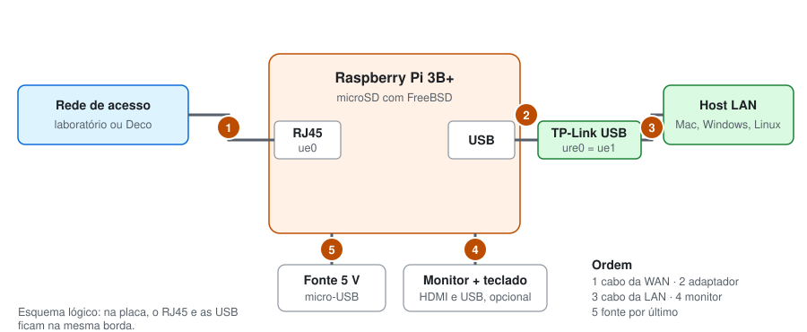

# Roteiro da apresentação

A demonstração diante do professor vale 70% da nota. Este roteiro organiza o dia: o que levar, o que ligar em quê, em que ordem mostrar cada requisito e o que dizer em cada momento.

As demonstrações seguem a história de [docs/2](2-um-dia-na-vida.md). Primeiro mostramos que a Pi é um roteador. Depois o host entra na rede (DHCP), navega (conectividade e NAT), alguém de fora tenta entrar (isolamento) e, por fim, entra pela porta permitida (DNAT).

## Papéis da dupla

| Pessoa | Opera | Narra |
| --- | --- | --- |
| A | Terminal da Pi, com duas sessões SSH abertas | Configuração e o que aparece no roteador |
| B | Host da LAN e máquina da WAN | O que cada teste prova |

São necessários dois computadores além da Pi: o host da LAN e a máquina da WAN. A máquina da WAN também pode abrir as sessões SSH na Pi, porque está na rede de acesso.

## Antes do dia

- [ ] Os testes 1 a 5 de [docs/4](4-testes.md) passaram em casa
- [ ] Os arquivos da Pi são iguais aos do projeto: copie de novo e valide (passos 6 e 7 de [docs/3](3-instalacao.md))
- [ ] O MAC de cada host que vai à LAN está na linha `dhcp-host`
- [ ] Os hosts estão preparados: `nc` ou `ncat`, `telnet`, `curl` e firewall liberado ([docs/4](4-testes.md#preparar-os-hosts))
- [ ] O ZIP foi entregue (veja [README](../README.md#montar-o-zip))
- [ ] Material na mochila: Pi com cartão e fonte, adaptador TP-Link, três cabos de rede (um de reserva), monitor HDMI e teclado se o laboratório não tiver, notebooks carregados
- [ ] Plano de emergência: imagem do FreeBSD e este repositório no notebook, para reinstalar sem internet

## Na bancada: montagem



1. Cabo 1: tomada de rede do laboratório até a porta RJ45 da Pi (`ue0`).
2. Adaptador TP-Link em uma porta USB da Pi (`ue1`).
3. Cabo 2: TP-Link até o host da LAN, com o Wi-Fi do host desligado.
4. Monitor e teclado, se houver.
5. Fonte, por último.

Enquanto a Pi sobe, pergunte ao professor três coisas: o valor de **X**, se a WAN usa DHCP ou IP fixo e qual DNS usar. Com IP fixo ou outro DNS, siga o [passo 10 de docs/3](3-instalacao.md#10-no-laboratório).

## Linha do tempo

| Tempo | Etapa | Quem |
| --- | --- | --- |
| 0 a 5 min | Montar e ligar | B |
| 5 a 10 min | Ajustar WAN e DNS, se preciso, e reiniciar | A |
| 10 a 12 min | Conferir o roteador ([passo 8 de docs/3](3-instalacao.md#8-conferir-o-roteador)) | A |
| 12 a 30 min | Demonstrações D1 a D6 | A e B |
| Final | Perguntas | Ambos |

Os tempos são estimativas. Se faltar tempo, D2, D4 e D6 cobrem os três serviços pedidos: DHCP, NAT e DNAT.

## Demonstrações

Cada demonstração tem o que mostrar, os comandos, o resultado esperado e uma fala curta com a referência do Kurose. Os comandos de host estão em [docs/4](4-testes.md#comandos-por-sistema), na coluna do sistema em uso.

### D1. A Pi é um roteador

**Mostrar:** duas interfaces em sub-redes diferentes e o repasse ligado.

```sh
ifconfig ue0
ifconfig ue1
sysctl net.inet.ip.forwarding
netstat -rn -f inet
```

**Esperado:** `ue0` com 192.168.X.Y, `ue1` com 10.10.0.1/16, `net.inet.ip.forwarding: 1` e a rota `default` via 192.168.X.1.

**Fala:** "Um roteador tem um IP em cada enlace (Kurose, p. 334). O `gateway_enable` liga o repasse, a função do plano de dados. Não rodamos protocolo de roteamento: a tabela tem três linhas, e a escolha segue o prefixo mais longo (p. 306 e 315)."

### D2. O host entra na rede: DHCP

**Mostrar:** as quatro etapas da concessão e a reserva do IP.

São usadas as duas sessões da Pi, como root. Antes de mexer no cabo, A deixa a captura aberta:

```sh
# Sessão 1
tcpdump -eni ue1 port 67 or port 68
```

B desconecta e reconecta o cabo do host da LAN. Quando os pacotes aparecerem na sessão 1, A procura a concessão mais recente:

```sh
# Sessão 2
grep DHCPDISCOVER /var/log/dnsmasq.log | tail -1
```

O número antes de `DHCPDISCOVER` é o ID da conversa, que muda a cada concessão (por exemplo, `1402673964`). A usa esse número no lugar de `ID_DA_CONVERSA` para mostrar as quatro etapas e depois mostra a lease:

```sh
# Sessão 2
grep ID_DA_CONVERSA /var/log/dnsmasq.log | grep -E "DHCP(DISCOVER|OFFER|REQUEST|ACK)"
cat /var/db/dnsmasq.leases
```

**Esperado:** quatro linhas com o mesmo ID, DHCPDISCOVER, DHCPOFFER, DHCPREQUEST e DHCPACK, com o MAC do host e o 10.10.0.10; no `tcpdump`, o destino `ff:ff:ff:ff:ff:ff`; no arquivo, a linha com o MAC do host.

Se o horário da linha do DHCPDISCOVER for antigo, a reconexão foi só uma renovação, com DHCPREQUEST e DHCPACK. Explique isso ao professor e siga com esse ID, que é o da última concessão completa.

**Fala:** "Sem IP, o cliente usa 0.0.0.0 e envia para a difusão 255.255.255.255, em UDP nas portas 67 e 68. O servidor entrega IP, máscara, gateway e DNS (p. 341–344). A reserva pelo MAC garante o 10.10.0.10, que é o alvo do DNAT."

### D3. Conectividade

**Mostrar:** o host chega ao gateway, resolve nomes e navega.

No host da LAN: ver IP, gateway e DNS; ping em 10.10.0.1; `nslookup www.freebsd.org`; `curl -I http://www.freebsd.org`. Se houver tempo, `traceroute` mostra 10.10.0.1 como primeiro salto.

**Esperado:** como no [teste 1 de docs/4](4-testes.md#1-conectividade).

**Fala:** "Para sair da sub-rede, o host manda tudo ao gateway. O quadro vai para o MAC da `ue1`, mas o datagrama leva o IP do destino final (§6.7, p. 515)."

### D4. NAT

**Mostrar:** a mesma conexão com origem privada na LAN e com o IP da WAN do lado de fora.

```sh
# Sessão 1
tcpdump -ni ue1 -c 4 tcp port 80

# Sessão 2
tcpdump -ni ue0 -c 4 tcp port 80
```

B pede a página no host da LAN. Em seguida, A roda `pfctl -s state | grep :80`.

**Esperado:** origem 10.10.0.10 na `ue1`, origem 192.168.X.Y na `ue0` e o estado com o endereço original entre parênteses.

**Fala:** "Endereços de 10.0.0.0/8 só têm sentido dentro da LAN. Para fora, a Pi aparece como um único IP e guarda IP e porta na tabela de tradução (p. 345–346). No pf, essa tabela é a tabela de estados."

### D5. Isolamento

**Mostrar:** a WAN não alcança a LAN diretamente, nem com rota forçada.

Siga o [teste 3 de docs/4](4-testes.md#3-isolamento-de-segmento): servidor na 8080 rodando na LAN, contador da regra de bloqueio antes, ping e TCP a partir da WAN com e sem rota, contador depois.

**Esperado:** tudo falha, nada chega ao servidor da LAN e o contador sobe.

**Fala:** "Sem mapeamento, ninguém de fora abre conexão pela tradução. Mas NAT não é firewall: com a rota forçada, quem bloqueia é a regra `block in on ue0`, o papel de firewall do roteador de acesso (p. 347)."

### D6. DNAT

**Mostrar:** uma conexão da WAN na porta 80 da Pi chega à 8080 do host da LAN.

Siga o [teste 5 de docs/4](4-testes.md#5-dnat-da-porta-80-para-a-8080): servidor na 8080 na LAN, cliente na WAN para `IP_WAN_DA_PI 80`, texto dos dois lados e `pfctl -s state | grep 8080` na Pi.

**Esperado:** o texto aparece do outro lado e o estado mostra a tradução para 10.10.0.10:8080.

**Fala:** "O DNAT é o mapeamento estático que o RFC 3022 prevê para sessões de entrada. O `rdr` marca o pacote com `tag DNAT`, e só o que tem a marca entra. A resposta volta pela Pi porque o host usa 10.10.0.1 como gateway."

### D7. Bloqueio de ping (só se pedido)

Siga o [teste 6 de docs/4](4-testes.md#6-bloqueio-de-ping-opcional).

## Perguntas prováveis

| Pergunta | Resposta curta |
| --- | --- |
| Por que FreeBSD? | O enunciado dá teto de 100% para \*BSD. O pf e o repasse vêm no sistema base, sem pacote de gateway pronto. |
| Repasse ou roteamento? | Repasse é local, em nanossegundos, no plano de dados. Roteamento calcula caminhos na rede toda, no plano de controle (p. 304–306). A Pi só repassa. |
| Por que 10.10.0.0/16? | O enunciado pede /16 em faixa privada. O bloco cabe em 10.0.0.0/8 (RFC 1918); 192.168.0.0/16 conteria a WAN do laboratório. |
| NAT e DNAT são diferentes? | É a mesma reescrita em sentidos opostos. No NAT, a conexão nasce na LAN e muda a origem. No DNAT, nasce na WAN e muda o destino. |
| Para que serve a `tag`? | O filtro vê o destino já traduzido. A marca separa o que passou pelo `rdr` do que foi enviado direto a 10.10.0.10:8080. |
| Primeira ou última regra vence? | Na tradução, a primeira. Na filtragem, a última, salvo uma regra `quick`. |
| Onde ficam as leases? | `/var/db/dnsmasq.leases`; as etapas, em `/var/log/dnsmasq.log`. |
| Quantas conexões o NAT aguenta? | O campo de porta tem 16 bits, então mais de 60 mil por IP de WAN (p. 346). |
| E se a Pi reiniciar? | A tabela de estados se perde e as conexões abertas caem. As leases ficam no arquivo, e o host mantém o IP. |
| Por que reiniciar em vez de `service pf start`? | Ligar o pf com o SSH aberto congela a sessão: o pf só cria estado a partir do SYN, e a sessão antiga não envia outro. |

## Plano B

| Problema na hora | Ação rápida |
| --- | --- |
| `ue0` e `ue1` invertidas | Troque os cabos de porta: a configuração segue o nome da interface |
| A Pi não recebe IP na WAN | `ifconfig ue0`; peça um IP fixo ao professor e siga o passo 10 de docs/3 |
| O host não recebe 10.10.0.10 | Confira o MAC em `/var/db/dnsmasq.leases` e acrescente-o à linha `dhcp-host` |
| O DNAT não chega | Servidor rodando, firewall do host, IP 10.10.0.10 e cliente usando o IP da `ue0` |
| O SSH caiu | Use monitor e teclado; `pfctl -d` desliga o firewall sem apagar as regras |
| O laboratório está sem Internet | Mostre o NAT com ping da LAN para 192.168.X.1 e `tcpdump -ni ue0 icmp`: a origem sai trocada do mesmo jeito |
| O cartão corrompeu | Reinstale com [docs/3](3-instalacao.md) a partir da imagem salva no notebook |
